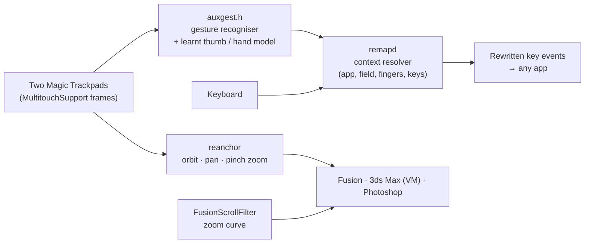

# Trackpad Gestures

**Custom multitouch input for macOS: a trackpad that works as a keyboard, CAD-style 3D navigation, and a context-aware key remapper.**

I built this to drive Autodesk Fusion, 3ds Max and Photoshop almost entirely from two Magic Trackpads, with no mouse. It reads raw contact frames from Apple's private `MultitouchSupport` framework (position, size, angle and shape of every finger, ~90 times a second), recognises gestures itself, and turns them into keys, modifiers and camera moves.

---

## Highlights

| | What it does |
|---|---|
| **Trackpad as a keyboard** (`auxgest.h`) | A gesture recogniser in plain C (no OS calls, so it can be ported). Taps, swipes, rolls, pinches and holds with 1–5 fingers each become a key. Fingers held still act as a held key with auto-repeat; fingers resting on one pad act as **modifiers** for the other pad. |
| **Thumb detection** (`thumbprint.m`) | A guided calibration session that learns what *your* thumb looks like on the glass versus a fingertip (contact shape, slant, where it lands relative to recent fingers), fits a small Gaussian classifier per pad and writes it to `models/thumbprint.json`. |
| **Whole-hand reading** | For a hand resting on the left pad, competing whole-hand hypotheses (fingertips / thumb / knuckles / palm) are scored together instead of judging each contact alone: 97% block accuracy, zero false triggers while idle. |
| **CAD navigation** (`reanchor.m`) | Two fingers orbit, three pan, thumb + two fingers pinch-zoom, in Fusion, 3ds Max (running in a Parallels VM, driven over a socket) and Photoshop. The orbit pivots on the geometry under the cursor. |
| **SketchUp-style zoom** (`FusionScrollFilter.c`) | A `CGEventTap` that reshapes zoom with a base curve, a velocity boost, distance-aware slow-down near the model and a "fling" to jump to a boundary. A Fusion add-in reports camera distances back to it. |
| **Context-aware remapper** (`remapd.m`) | One daemon decides what a key means given *where you are*: app, focused field, held trackpad fingers, held keys. Bindings declare a domain of `axis:value` pairs; the most specific match wins, and conflicts are derived instead of hand-declared. Events are rewritten in place and latched per keycode, so a modifier finger lifting mid-press never leaves a key stuck. |
| **Distance zoom** (`distance_zoom.m`) | Uses the webcam and Apple Vision's person segmentation to measure how far you are from the screen and scales the UI to match, with hysteresis so it doesn't pump. |
| **Haptics** (`haptic.m`) | Fires the trackpad's actuator directly, because the public `NSHapticFeedbackManager` silently does nothing from a background process. |

## How it fits together



## Files

```
src/
├── auxgest.h            Gesture recogniser (taps, swipes, rolls, pinches, holds; thumb + resting-hand logic)
├── thumbprint.m         Guided calibration → per-pad thumb / hand / roll classifiers
├── remapd.m             Context-aware keyboard + trackpad remapper (CGEventTap daemon)
├── reanchor.m           Trackpad CAD navigation for Fusion, 3ds Max and Photoshop
├── reanchor_pan.c       Minimal pan-only variant
├── FusionScrollFilter.c SketchUp-style zoom for Fusion's viewport
├── distance_zoom.m      Camera-based "zoom with distance from the screen"
├── haptic.m             Trackpad actuator tap
└── auxpad.h  hidpoint.h  navwords.h   Shared device / event / IPC helpers
models/
├── thumbprint.json      A learnt thumb/hand model (output of thumbprint)
└── auxpad.json          Which pad is the left-hand pad
```

Every source file starts with a long header explaining why it exists, the design decisions and its build line, e.g.:

```bash
clang -O2 -fobjc-arc -o reanchor src/reanchor.m -framework Cocoa -framework CoreGraphics -framework ApplicationServices -framework IOKit -F/System/Library/PrivateFrameworks -framework MultitouchSupport
```

## Notes

This is a working snapshot of a personal system, not a packaged product. The daemons expect Accessibility / Input Monitoring permission, some paths and config files from the larger setup they came from (a central `bindings.json`, `/tmp` handoff files, companion Fusion add-ins in [fusion-360-tools](https://github.com/JoshCallis/fusion-360-tools)), and macOS on Apple Silicon. `MultitouchSupport` is a private Apple framework.
